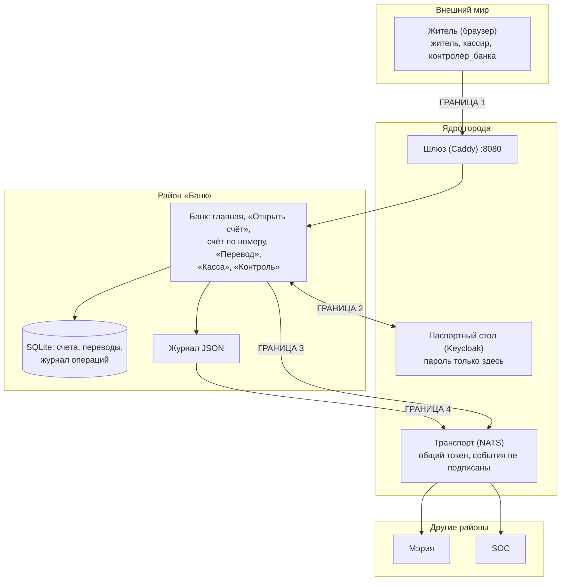

# Модель угроз района «Банк»

Команда 5: Москаленко Никита Петрович (тимлид-архитектор), Жиляков Максим Николаевич (инженер инфраструктуры), Бородихин Артур Дмитриевич (инженер безопасности), Буташев Константин Александрович (разработчик-аналитик)
Дата: 30.10.2026

## 1. Что строим

**Назначение.** Банк хранит счета жителей, проводит переводы между счетами, принимает пополнения через кассу и требует подтверждения крупных переводов (больше 50 000 ₽) контролёром банка.

**Кто пользуется (роли):**
- `житель` — свои счета, переводы, история;
- `кассир` — пополнение счёта (касса);
- `контролёр_банка` — подтверждает/отклоняет крупные переводы (> 50 000 ₽);
- служебно: Мэрия — получатель события о переводе; SOC — получатель журнала.

**Данные:**
- счета: номер, владелец (логин), баланс;
- переводы: откуда, куда, сумма, статус, кто инициировал, кто подтвердил;
- журнал операций: кто, что, когда, результат.

**Страницы:** главная со своими счетами, «Открыть счёт», счёт по номеру, «Перевод», «Касса», «Контроль».

**Связи с городом:**
- публикует `city.bank.transfer.completed.v1` («перевод проведён») → слушает Мэрия;
- пишет журнал в JSON → копия `city.logs.bank` → Транспорт → SOC;
- получает вход/роли от Паспортного стола (Keycloak);
- весь внешний трафик — через Шлюз (Caddy :8080).

**Схема (mermaid):**

**Границы доверия:**

1. браузер жителя → Шлюз → Банк (формы, URL, cookie);
    
2. Банк ↔ Паспортный стол (логин, имя, роли);
    
3. Банк → Транспорт → другие районы (событие о переводе, журнал);
    
4. Банк → журнал → SOC (доказательства).
    

## 2. Активы

|Актив|Почему ценен|Что будет, если потеряем|
|---|---|---|
|Деньги на счетах|прямая ценность жителя|кража/списание, репутационный ущерб|
|Балансы и статусы переводов (целостность)|от них зависят деньги|двойное списание, «проведён» без денег|
|История переводов|доказательство операций|нельзя разобрать спор, нет аудита|
|Учётные записи и роли|доступ к операциям|повышение прав, чужие действия|
|Журнал операций|доказательство «кто подтвердил»|нельзя доказать отказ от действия|
|Доступность сервиса|житель платит/получает|отказ в обслуживании, паника|

## 3. Нарушители

|Кто|Чего хочет|Что может|
|---|---|---|
|Любопытный житель|чужое|вошёл под своим логином, меняет номера/суммы в адресах и формах, шлёт запросы в обход интерфейса|
|Нечестный сотрудник (кассир, контролёр)|выгода|злоупотребляет ролью: пополняет себе, подтверждает свой крупный перевод|
|Укравший пароль|чужие деньги|входит под чужим именем, Паспортный стол не отличит|
|Чужой сервис в сети города|влияние/саботаж|публикует события и журналы от имени Банка по общему токену Транспорта|
|Посторонний|разведка|видит сеть, но не имеет учётной записи|
|Преступник (внешний мошенник)|деньги жителей|фишинг и подстановка учётных данных, обман жителя («поменялись реквизиты»), вывод денег через подставные счета (дропы)|
|Государственный противник|наблюдение, влияние|перехватывает межбанковские/городские потоки и метаданные (кто, кому, сколько, когда)|

## 4. Угрозы 

| №   | Буква                    | Граница                     | Угроза: кто – что делает – через что                                                                              | Мера                                                                                                                              | Как проверим                                                                                             |
| --- | ------------------------ | --------------------------- | ----------------------------------------------------------------------------------------------------------------- | --------------------------------------------------------------------------------------------------------------------------------- | -------------------------------------------------------------------------------------------------------- |
| 1   | S - подмена              | браузер → Банк (Г1)         | житель подставляет в cookie/заголовок чужой логин, выдаёт себя за другого                                         | сессия подписывается на сервере; логин берётся только из сессии, не из формы/URL                                                  | войти как `petrova`, подменить в cookie логин на `ivanov` → доступ отклонён, в журнале — отказ           |
| 2   | S - подмена              | Транспорт → Банк (Г3)       | чужой сервис публикует `city.bank.transfer.completed.v1` от имени Банка                                           | принимать событие только от Банка: сверять источник/подпись/allowlist; входящие события других районов Банк не исполняет как свои | отправить тестовой программой фальшивое событие → Банк его игнорирует/пишет тревогу, балансы не меняются |
| 3   | T - изменение            | браузер → Банк (Г1)         | житель меняет в запросе перевода номер счёта-отправителя на чужой                                                 | счёт-отправитель берётся по номеру **и владельцу из сессии**; чужой счёт — как несуществующий (404)                               | войти как `petrova`, отправить перевод с номером счёта `ivanov` → 404, деньги не ушли, в журнале отказ   |
| 4   | T - изменение            | браузер → Банк (Г1)         | житель отправляет отрицательную сумму или сумму больше баланса                                                    | серверная валидация: сумма > 0, ≤ баланса, лимиты; проверка на каждом действии                                                    | отправить перевод с суммой `-100` и `> баланса` → ошибка, баланс не изменён                              |
| 5   | T - изменение            | Транспорт → Банк (Г3)       | подделка события о переводе меняет статус/баланс (если Банк слушает свои же события)                              | Банк не меняет балансы по входящим событиям; события — только уведомление Мэрии; источник проверяется                             | опубликовать событие «перевод проведён» на несуществующий перевод → баланс не меняется                   |
| 6   | R - отказ от действия    | браузер → Банк (Г1)         | контролёр подтверждает крупный перевод и говорит «это не я»                                                       | журнал: кто, что, когда, результат, id перевода; запись при подтверждении/отклонении                                              | подтвердить перевод как `controller1`, проверить журнал → есть запись с логином, временем, id            |
| 7   | R - отказ от действия    | Банк → журнал → SOC (Г4)    | кассир пополняет себе счёт и отрицает; журнал неполный                                                            | обязательная запись кассовых операций с инициатором и получателем; копия в SOC                                                    | пополнить счёт как `cashier1`, проверить `city.logs.bank` → запись есть у Банка и в SOC                  |
| 8   | I - утечка               | браузер → Банк (Г1)         | житель открывает `/account/<номер>` чужого счёта по номеру                                                        | проверка владельца на сервере; чужой счёт — 404 (не 403), без раскрытия существования                                             | войти как `petrova`, открыть счёт `ivanov` по номеру → 404, данных нет                                   |
| 9   | I - утечка               | Банк → журнал → SOC (Г4)    | в журнал попадают секреты/полные номера, журнал читает лишний                                                     | в журнал — без паролей/токенов; маскирование номеров; доступ к журналу только роли SOC/аудита                                     | просмотреть журнал → нет паролей/токенов, номера маскированы                                             |
| 10  | D - отказ в обслуживании | браузер → Банк (Г1)         | житель шлёт тысячи запросов перевода/открытия счёта, Банк «ложится»                                               | ограничение частоты и размера запросов на маршрутах перевода/кассы; таймауты                                                      | скриптом отправить 1000 запросов/сек → часть отклоняется 429, сервис отвечает                            |
| 11  | E - повышение прав       | браузер → Банк (Г1)         | житель открывает `/cashier` или `/control` и пополняет/подтверждает себе                                          | проверка роли на сервере на каждой странице и действии (не только скрытие кнопки)                                                 | войти жителем, открыть `/cashier` и `/control` → 403, в журнале отказ доступа                            |
| 12  | E - повышение прав       | Паспортный стол → Банк (Г2) | пользователь с ролью `житель` получает в токене лишнюю роль `контролёр_банка` (или Банк доверяет роли из запроса) | Банк сам сопоставляет роли из проверенного токена Паспортного стола; роли из формы/URL игнорируются                               | войти жителем, подставить в запрос `role=контролёр_банка` → 403, роль не применяется                     |
| 13  | T - изменение            | браузер → Банк (Г1)         | сбой или умышленный обрыв перевода: со счёта списано, на счёт не зачислено (или наоборот), баланс «не сходится» | двойная запись: перевод — одна транзакция БД «дебет = кредит»; при ошибке откат; сверка суммы по всем счетам | оборвать перевод посреди операции (ошибка/исключение) → оба баланса прежние, сумма по всем счетам не изменилась |
| 14  | E - повышение прав       | браузер → Банк (Г1)         | контролёр подтверждает собственный крупный перевод (> 50 000 ₽) или один человек проводит весь цикл операции | разделение полномочий: подтверждающий ≠ инициатор; отказ при совпадении логинов | войти как `controller1`, создать крупный перевод и подтвердить его самому → отказ, в журнале запись о попытке |

## 5. Чего не защищаем и почему

- **От владельца компьютера, на котором запущен город** — он может читать файлы БД и журналы напрямую; это вне периметра района.
    
- **От взлома самого Паспортного стола (Keycloak)** — это ядро, его делает преподаватель; Банк доверяет выданному токену.
    
- **От компрометации общего токена Транспорта на уровне ядра** — токен один для всех районов; Банк проверяет источник события, но не может починить саму шину.
    
- **От физического доступа к серверу/диску** — вне модели.
    
- **От социальной инженерии жителя (отдал пароль мошеннику)** — частично: журнал и подтверждение крупных переводов снижают ущерб, но полностью не закрываем.
    
- **От компрометации деловой переписки и обналичивания через дропов за пределами города** — вне системы; на уровне Банка снижаем ущерб подтверждением крупных переводов и журналом для атрибуции.
    
- **От государственного противника, наблюдающего межбанковские потоки и метаданные** — вне периметра района; защита каналов и шины — задача ядра города.
    
- **Организационные меры против инсайдера (обязательные отпуска, ротация сотрудников)** — кодом не реализуются, только рекомендация.
    

## 6. Вопросы к коду (сверим на паре 4)
- Есть ли в заготовке мера для угрозы №...?